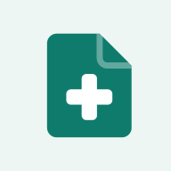

<p align="center">
  
</p>

<h1 align="center">DrDoc: Doctor Document</h1>

<p align="center">
  Edit, convert, organize and compress PDFs and Office files, entirely in your browser.<br>
  No uploads, no accounts, no servers. Works on desktop and phone.
</p>

---

## Why DrDoc

Most online PDF tools upload your files to someone else's server. DrDoc does every job **on your device**: a PDF engine (MuPDF compiled to WebAssembly) runs inside the browser tab, so contracts, IDs and medical records never leave your computer or phone. After the first visit it also **works offline**.

## Features

**Edit**
- **Edit PDF**: click any line of existing text and retype it. DrDoc keeps the original font, size, colour and bold/italic runs. If the document's embedded font is missing characters you typed, it substitutes a metric-compatible font (Calibri → Carlito, Cambria → Caladea, Arial → Helvetica, Times → Times) so line lengths stay right.
- Add text, images, signatures (draw, type or upload), white-out and highlights. Undo and redo throughout.
- **Sign PDF**, add page numbers, add watermarks.

**Organize**
- **Organize pages**: thumbnails of every page; drag to reorder (touch works too), rotate, delete, duplicate, insert blank pages.
- **Merge**: combine PDFs *and images*, reorder whole files by dragging their chips, or reorder individual pages across files.
- Split (every page, chunks or custom groups), extract pages, remove pages, rotate.

**Optimize & secure**
- Compress (re-encodes and downsamples images; text stays vector), protect with AES-256 passwords, unlock, repair damaged files, greyscale.

**Convert to PDF**: images (JPG, PNG, WebP, HEIC from iPhone), Word (.docx), PowerPoint (.pptx), Excel/CSV, Markdown, HTML, plain text, EPUB, and **Scan to PDF** with the phone camera (with automatic paper clean-up).

**Convert from PDF**: Word (.docx with fonts, headings, lists and images), images, PowerPoint, text, Markdown, HTML.

**Documents & images**: Word ↔ Markdown, Word → HTML/text, HTML ↔ Word/Markdown, Markdown → HTML, Excel ↔ CSV, Excel → JSON, PowerPoint → images, image format conversion and resizing.

See [docs/TOOLS.md](docs/TOOLS.md) for every tool, its options and its limits.

## Quick start

Requires Node.js 20 or newer.

```bash
npm install
npm run dev        # http://localhost:5173
```

```bash
npm test           # engine tests (Node)
npm run build      # type-check + production build into dist/
npm run preview    # serve the production build locally
```

## Deploy to Netlify

The repo is ready for Netlify: `netlify.toml` sets the build command, publish folder, Node version, caching and security headers.

1. Push this folder to a GitHub repository.
2. In Netlify: **Add new site → Import an existing project →** pick the repo.
3. Netlify reads `netlify.toml`; just press **Deploy**.

Other options (Netlify CLI, drag-and-drop of `dist/`) are in [docs/DEPLOYMENT.md](docs/DEPLOYMENT.md).

## How it works

```
React UI ──postMessage──▶ Web Worker ──▶ MuPDF (WebAssembly)
   │                                    render · edit · merge · compress · encrypt
   ├─ mammoth (Word → HTML) ─┐          · lay out HTML/Markdown/EPUB into pages
   ├─ marked (Markdown)      ├─ HTML ─▶ MuPDF layout engine ─▶ PDF
   ├─ SheetJS (Excel/CSV) ───┘
   ├─ custom PPTX renderer (canvas) ─▶ PDF / images
   ├─ docx (writes .docx)  ·  turndown (HTML → Markdown)  ·  pptxgenjs
   └─ canvas (images, HEIC via heic2any, scan clean-up)
```

Heavy PDF work runs in a Web Worker so the page stays responsive. Details in [docs/ARCHITECTURE.md](docs/ARCHITECTURE.md).

## Project structure

```
├── .github/              CI workflow, issue and PR templates, Dependabot
├── docs/                 architecture, tools reference, deployment guide
├── public/               static files: icons, manifest, editor fonts
├── scripts/              icon generator, service-worker build plugin
├── src/
│   ├── app/              hash router and file hand-off between pages
│   ├── components/       UI building blocks (drop zone, file list, dialogs…)
│   ├── engine/
│   │   ├── pdf/          MuPDF engine (core.ts), worker, font matching
│   │   └── convert/      Word, Markdown, Excel, PowerPoint, image converters
│   ├── lib/              file naming, zip, download, page-range parser
│   ├── pages/            Home, ToolPage, Editor, Organizer, Scanner
│   ├── styles/           design tokens and styles (light + dark)
│   └── tools/registry.ts every tool: name, category, options, run()
├── tests/                engine tests (Vitest, run in Node)
├── index.html
├── netlify.toml
└── vite.config.ts
```

## Browser support

Current Chrome, Edge, Firefox and Safari (desktop and mobile). The PDF engine needs WebAssembly and module workers, available in all of them. Saving WebP images needs Chrome, Edge or Firefox.

## Known limits

- **Scanned PDFs** have no selectable text, so PDF → Word/Markdown/Text has nothing to extract (no OCR yet).
- **PowerPoint → PDF** draws slides as high-resolution images. Charts, SmartArt and EMF graphics are skipped.
- **Word → PDF** keeps headings, lists, tables, images and emphasis, but not exact page layout (headers, footers, columns, page breaks).
- **Editing** works line by line; it does not reflow whole paragraphs.

## License

Copyright © 2026 Chirag Panchal. Released under [AGPL-3.0-or-later](LICENSE). DrDoc is built on [MuPDF](https://mupdf.com) (AGPL). If you run a modified version as a public service, you must publish your source code. Bundled fonts Carlito and Caladea are under the SIL Open Font License (see `public/fonts`).
